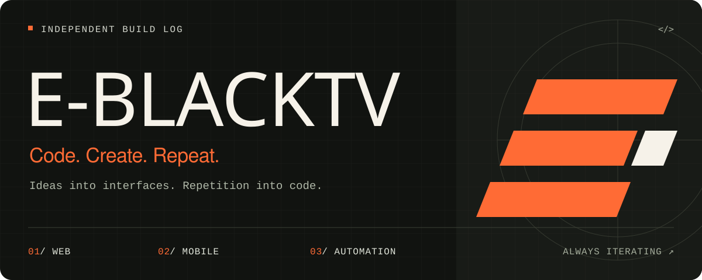
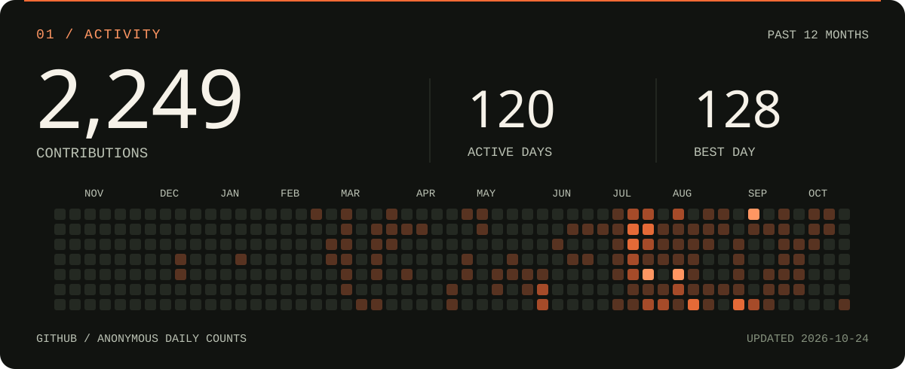
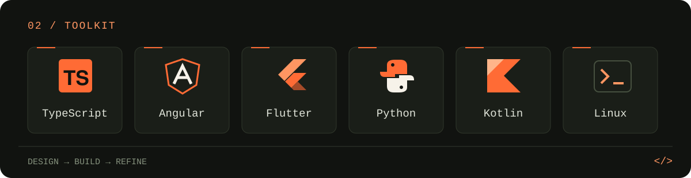

<picture>
  <source media="(max-width: 600px)" srcset="./assets/banner-mobile.svg">
  
</picture>

<picture>
  <source media="(max-width: 600px)" srcset="./assets/activity-mobile.svg">
  
</picture>

<picture>
  <source media="(max-width: 600px)" srcset="./assets/toolkit-mobile.svg">
  
</picture>

